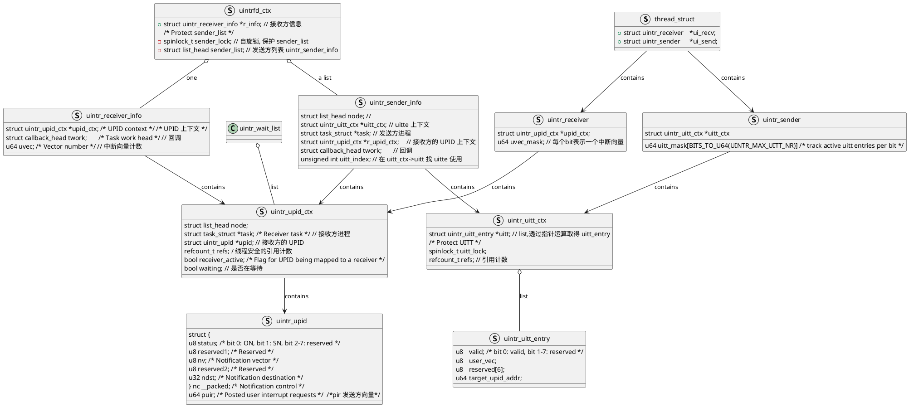

基于 <https://github.com/OS-F-4/uintr-linux-kernel/commits/uintr-next>

- 实际上与 <https://github.com/intel/uintr-linux-kernel/tree/rfc-v1> 一致
- 内部镜像 [zhangyang/uintr-linux-kernel](https://git.mesalab.cn/zhangyang/uintr-linux-kernel)
- Linux 5.15-rc1

## 应用层接口

一个 sample.c

```c
unsigned int uintr_received, uintr_fd;
void __attribute__ ((interrupt)) uintr_handler(struct __uintr_frame *ui_frame,unsigned long long vector){ // 用户态中断处理函数, 功能为将uintr_received置1
	uintr_received = 1;
}

void *sender_thread(void *arg){ // 发送方线程执行的函数
	int uipi_index = uintr_register_sender(uintr_fd, 0);// 注册sender
	_senduipi(uipi_index); // 通过senduipi发送中断
	uintr_unregister_sender(uintr_fd, 0);// 注销sender
	return NULL;
}

int main(int argc, char *argv[])
{
	pthread_t pt;
	uintr_register_handler(uintr_handler, 0) // 注册handler
	uintr_fd = uintr_create_fd(0, 0); // 接收方创建链接, 给发送方调用

	_stui(); // 使能中断
	//创建线程调用发送函数
	pthread_create(&pt, NULL, &sender_thread, NULL)

	/* 进入循环, 等待中断 */
	// 等待用户态中断将uintr_received置为 1,退出死循环,正常退出程序。
	while (!uintr_received)
		usleep(1);
	// 收尾工作
	pthread_join(pt, NULL); close(uintr_fd);
	uintr_unregister_handler(0);
	printf("Success\n"); exit(EXIT_SUCCESS);
}
```

系统调用列表:

| 名称                       | 功能                             | 描述                                       |
| ------------------------ | ------------------------------ | ---------------------------------------- |
| uintr_register_handler   | 用户态中断 接收方 注册中断处理函数             | 操作系统会将 中断处理函数的地址 写入硬件, 硬件收到中断直接跳转到中断处理函数 |
| uintr_unregister_handler | 接收方 注销 中断处理函数                  | 注销后硬件将不在记录 中断处理函数地址                      |
| uintr_create_fd          | 创建 中断向量 `vector` (封装是 文件描述符FD) | 接收方创建,传递给发送方.进入中断处理函数参数带有该值,以区分不同发送方     |
| uintr_register_sender    | 发送方 注册 `sender` 文件描述符          |                                          |
| uintr_unregister_sender  | 注销用户态中断的发送方                    |                                          |
|                          |                                |                                          |

## kernel

包含文件

- arch/x86/include/asm/uintr.h
- arch/x86/kernel/uintr_core.c
- arch/x86/kernel/uintr_fd.c

### 基本数据结构

接收方基本数据结构为 UPID 接收方为 UITT,两者由硬件手册定义.



#### UPID

UPID 为用户态中断接收方维护的数据结构,定义在 uintr.h

```c
/* User Posted Interrupt Descriptor (UPID) */
struct uintr_upid {
	struct {
		u8 status;	/* bit 0: ON, bit 1: SN, bit 2-7: reserved */
		u8 reserved1;	/* Reserved */
		u8 nv;		/* Notification vector */
		u8 reserved2;	/* Reserved */
		u32 ndst;	/* Notification destination */
	} nc __packed;		/* Notification control */
	u64 puir;		/* Posted user interrupt requests */
} __aligned(64);
```

- 0 ON: 当前是否有中断
- 1 SN: 中断使能状态
- 2-15: 保留,必须为 0
- 16-23 nv: 中断编号
- 24-31: 保留,必须为 0
- 32-63 ndst: 中断目标,接收方所在的物理核心号
- 64-127 puir|PIR: 标志着那些发送方发送了用户中断

#### UITT

UITT 为中断发送方维护的数据结构, 为一张表 表中的一项为 UITTE 的指针, 指向 UITTE 结构体, UITTE 中主要标记了发送 UPID 的地址以及使能以及当前发送方持有的中断向量。

```c
/* User Interrupt Target Table Entry (UITTE) */
struct uintr_uitt_entry {
	u8	valid;			/* bit 0: valid, bit 1-7: reserved */
	u8	user_vec;
	u8	reserved[6];
	u64	target_upid_addr;
} __packed __aligned(16);

struct uintr_uitt_ctx {
	struct uintr_uitt_entry *uitt;
	/* Protect UITT */
	spinlock_t uitt_lock;
	refcount_t refs;
};
```

- 0 valid: 合法位
- 1-7 reserved: 保留,必须为 0
- 8-15 uv: 发送方中断向量
- 16-63 reserved: 保留
- 64-127 target_upid_addr: 接收方 UPID 的地址,因为内存对齐,低 6 位必须为 0.

### 函数

详细注释请参考 [uintr-next](https://git.mesalab.cn/zhangyang/uintr-linux-kernel/-/tree/uintr-next) 分支;

应用层接口都是通过系统调用形式定义

#### uintr_register_handler(handler, flags)

```c
SYSCALL_DEFINE2(uintr_register_sender, int, uintrfd, unsigned int, flags)
```

```c
uipi_index = uintr_register_sender(uintr_fd, 0);
#define __NR_uintr_register_sender	452
#define uintr_register_sender(fd, flags)	syscall(__NR_uintr_register_sender, fd, flags)
# uintr_fd.c
# SYSCALL_DEFINE2 是系统调用的简化宏 == 2个参数的系统调用.(函数名,参数1类型,参数1名称,参数2类型,参数2名称)
SYSCALL_DEFINE2(uintr_register_sender, int, uintrfd, unsigned int, flags)
```

#### uintr_register_handler(handler, flags)

uintr_register_handler(uintr_handler, 0)

#### uintr_create_fd(vector, flags)

uintr_create_fd(0, 0)

到 uintr_create_fd

#### uintr_register_sender(fd, flags)

uintr_register_sender(uintr_fd, 0);

###

_senduipi(uipi_index) 真正发送用户中断

#### uintr_unregister_sender(fd, flags)

uintr_unregister_sender(uintr_fd, 0);

### 硬件寄存器

与 uitt 有关

MSR_IA32_UINTR_MISC

MSR_IA32_UINTR_TT

##

uintr_core -- switch_uintr_prepare 接收方不活跃时候将发送方信息写入内存,关闭此线程 uintr 中断,不再有进一步动作.

- 修改应该是这里了.

  ```
    // just wakeup the sender
    wake_up_process(prev);
  ```

uintr_core -- switch_uintr_return 就是接收方线程再次活跃时候调用的函数

##

`switch_uintr_prepare` 在 `__switch_to` 中调用. 任务换出前最后执行, 关闭目前的 upid.sn

`switch_uintr_return` 在 `arch_exit_to_user_mode_prepare()` 中调用,为换入任务恢复上下文, 并检查有没有发送方中断.

`uintr_free` 仅在 `exit_thread()` 中调用 清理

`uintr_wake_up_process` 追踪

##

追踪 `#ifdef CONFIG_X86_USER_INTERRUPTS`

`arch/x86/include/asm/hardirq.h`

```c
// 中断数量?
unsigned int uintr_spurious_count;
unsigned int uintr_kernel_notifications;
```

`arch/x86/include/asm/idtentry.h`

```c
DECLARE_IDTENTRY_SYSVEC(UINTR_NOTIFICATION_VECTOR,	sysvec_uintr_spurious_interrupt);
DECLARE_IDTENTRY_SYSVEC(UINTR_KERNEL_VECTOR,		sysvec_uintr_kernel_notification);
```

- 两个中断描述符表（IDT）条目,应该是处理中断时跳转到具体条目.
- UINTR_NOTIFICATION_VECTOR

`arch/x86/kernel/idt.c`

```c
INTG(UINTR_NOTIFICATION_VECTOR,		asm_sysvec_uintr_spurious_interrupt),
INTG(UINTR_KERNEL_VECTOR,		asm_sysvec_uintr_kernel_notification),
```

- 中断描述符, 相当于中断处理程序的入口地址.
- 这里的入口相当于是汇编编写的函数

`arch/x86/kernel/irq.c`

```c
#ifdef CONFIG_X86_USER_INTERRUPTS
/*
 * Handler for UINTR_NOTIFICATION_VECTOR.
 *
 */
DEFINE_IDTENTRY_SYSVEC_SIMPLE(sysvec_uintr_spurious_interrupt)
{
	/* TODO: Add entry-exit tracepoints */
	ack_APIC_irq();
	inc_irq_stat(uintr_spurious_count);
}

/*
 * Handler for UINTR_KERNEL_VECTOR.
 */
DEFINE_IDTENTRY_SYSVEC(sysvec_uintr_kernel_notification)
{
	/* TODO: Add entry-exit tracepoints */
	ack_APIC_irq();
	inc_irq_stat(uintr_kernel_notifications);

	uintr_wake_up_process();
}
#endif
```

- DEFINE_IDTENTRY_SYSVEC_SIMPLE -> UINTR_NOTIFICATION_VECTOR;  处理 发送方的发送
- DEFINE_IDTENTRY_SYSVEC -> UINTR_KERNEL_VECTOR; 给接收方发送?

```c
arch_show_interrupts{
xx
#ifdef CONFIG_X86_USER_INTERRUPTS
	seq_printf(p, "%*s: ", prec, "UIS");
	for_each_online_cpu(j)
		seq_printf(p, "%10u ", irq_stats(j)->uintr_spurious_count);
	seq_puts(p, "  User-interrupt spurious event\n");

	seq_printf(p, "%*s: ", prec, "UKN");
	for_each_online_cpu(j)
		seq_printf(p, "%10u ", irq_stats(j)->uintr_kernel_notifications);
	seq_puts(p, "  User-interrupt kernel notification event\n");
#endif
xx
}
```

- 这一段就是在 /sys/kernel/debug/irq/下能看到 uintr 的统计信息

`arch/x86/include/asm/processor.h`

```c
struct uintr_receiver	*ui_recv;
struct uintr_sender	*ui_send;
```

- 线程保存的状态

`arch/x86/kernel/process.c`

```c
int arch_dup_task_struct(struct task_struct *dst, struct task_struct *src){
#ifdef CONFIG_X86_USER_INTERRUPTS
	/* User Interrupt state is unique for each task */
	dst->thread.ui_recv = NULL;
	dst->thread.ui_send = NULL;
#endif
}
```

- 线程 fork 时候使用, 清空 ui_recv ui_send 防止干扰.

## 手册

UIRR: 用户中断请求寄存器 包含了 64 个用户中断向量的每个位.

- 如果 UIRR[i] = 1，则表示向量 i 的用户中断正在请求服务。
- UIRV 是指 UIRR 中最高位设置的位置；如果 UIRR = 0，则 UIRRV = 0
- 似乎是 uintr_receiver -> uvec_mask

UIF: 用户中断标志

- UIF = 0，则用户中断传递被阻止；如果 UIF = 1，则可以传递用户中断。
- 用户中断传递会清除 UIF.
- 与 IA32_UINTR_MISC 有关

UIHANDLER: handle 函数的地址

- 关联到 MSR_IA32_UINTR_HANDLER

UISTACKADJUST 用户中断堆栈的调整值

- MSR_IA32_UINTR_STACKADJUST

UINV 用户中断通知向量

- 是那些被视为用户中断通知的普通中断的向量（参见第 11.5.1 节）。
- 逻辑处理器接收到用户中断通知时，它会在 UPIDADDR（见下文和第 11.5.2 节）引用的用户发布的中断描述符（UPID）中处理用户中断。
- MSR_IA32_UINTR_MISC 的 39:32

UPIDADDR 用户发布的中断描述符地址

- 逻辑处理器在接收到具有向量 UINV 的普通中断时所查询的 UPID 的线性地址
- MSR_IA32_UINTR_PD
- 对应 ui_recv->upid_ctx->upid

UITTADDR 是用户中断目标表的线性地址

- 调用 SENDUIPI 指令时，逻辑处理器会查询。
- (u64)ui_send->uitt_ctx->uitt | 1

UITTSZ: UITT 的现在容量

- MSR_IA32_UINTR_MISC 的 31:0

```c
MSR_IA32_UINTR_RR		0x985
MSR_IA32_UINTR_HANDLER		0x986 // 接收者的 handle 函数地址
MSR_IA32_UINTR_STACKADJUST	0x987
MSR_IA32_UINTR_MISC		0x988	/* 39:32- UINV, 31:0-UITTSZ 40-63 是保留位.
MSR_IA32_UINTR_PD		0x989 // upid 的地址
MSR_IA32_UINTR_TT		0x98a
```

MSR_IA32_UINTR_RR

- UIRR 的当前值

MSR_IA32_UINTR_HANDLER

- UIHANDLER handle 函数的地址

MSR_IA32_UINTR_STACKADJUST

- 用户中断传递如何更新堆栈指针

MSR_IA32_UINTR_PD

-  UPIDADDR 的当前值
- 5:0 保留

MSR_IA32_UINTR_TT

- 63:4 保存 UITTADDR 的当前值
- 3:1 保留
- 位 0 确定是否启用 SENDUIPI 指令

